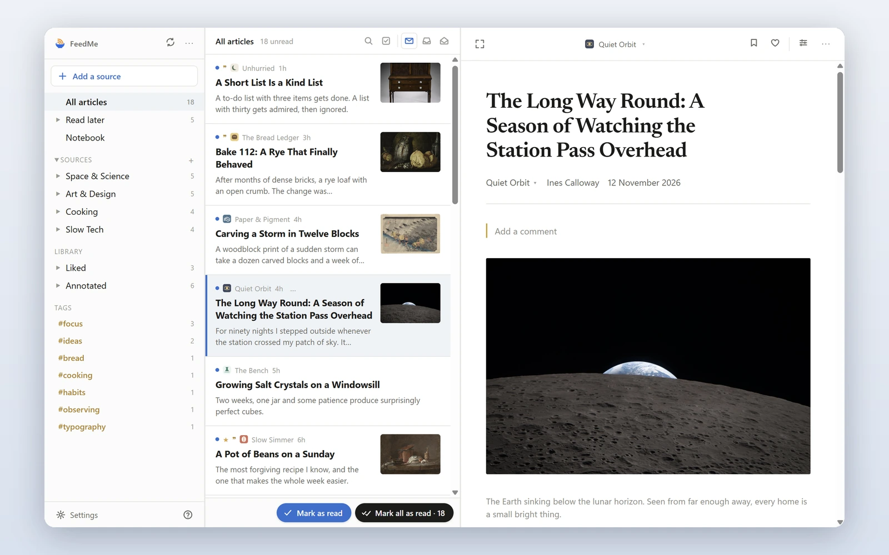
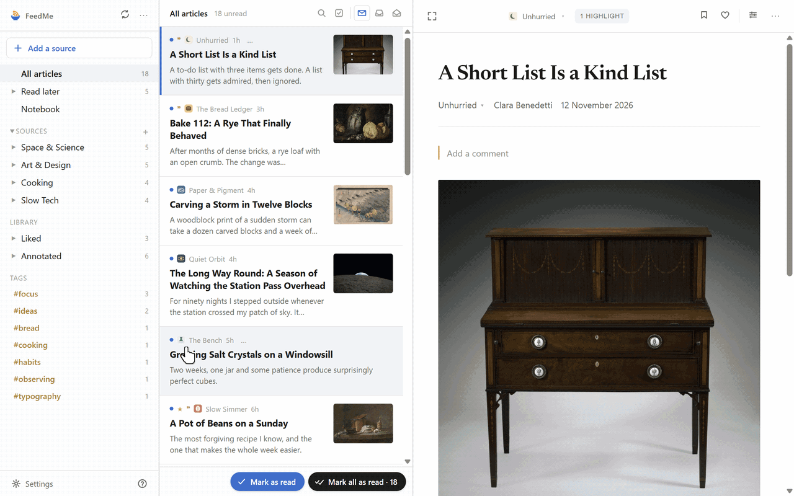
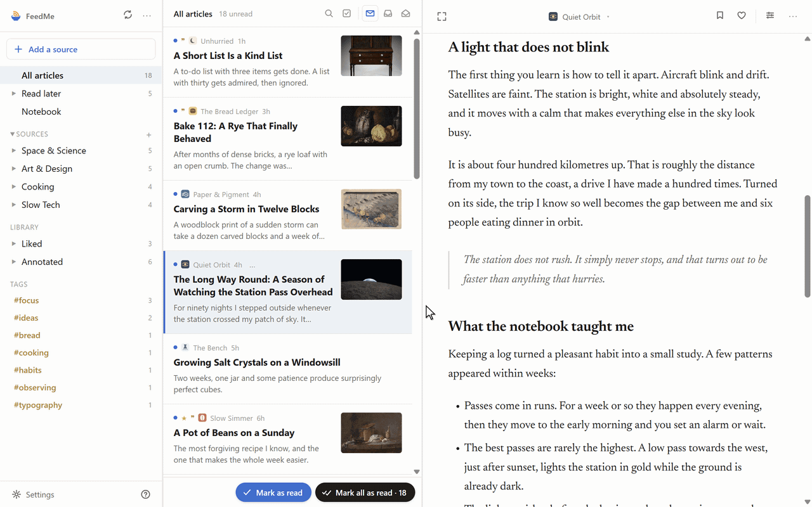
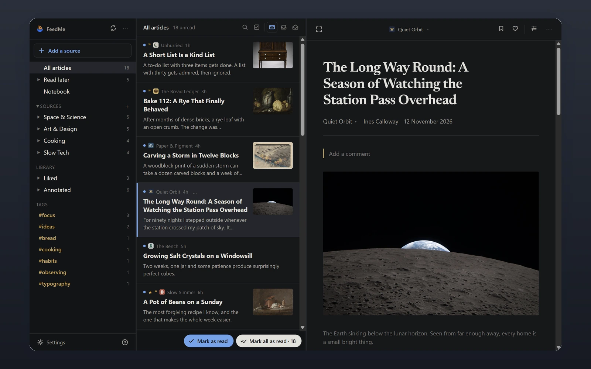

# FeedMe

A calm, private feed reader for Windows. Follow websites, YouTube channels and subreddits, save
pages for later, highlight what matters and find it again. No account, no ads, no tracking: your
library stays on your computer.



## Download

- **[Installer](https://github.com/arnaudgastelblum/feedme-releases/releases/latest/download/FeedMe-setup.exe)**:
  installs for the current user, no administrator rights needed.
- **[Standalone](https://github.com/arnaudgastelblum/feedme-releases/releases/latest/download/FeedMe-portable.zip)**:
  unzip it anywhere and run `FeedMe.exe`, no installation needed. Your library stays in the
  `FeedMe Data` folder next to it.

Every version, with its notes and checksums, is on the
[Releases](https://github.com/arnaudgastelblum/feedme-releases/releases) page.

Requirements: Windows 10 (version 1809 or later) or Windows 11, 64-bit.

How it works, with pictures: [lazysnail.net/tools/feedme](https://www.lazysnail.net/tools/feedme).

## Features

- **Follow anything with a feed**: paste the address of a website or a blog and FeedMe finds its
  feed (RSS, Atom, JSON Feed), with a preview before you follow. YouTube channels and subreddits
  work the same way. Sections, mute, OPML import and export.
- **Read comfortably**: a typeset reading view with three fonts, adjustable size and width, light
  and dark themes, a focus mode, and your reading position kept per article. One key loads the
  full article when a feed only gives a summary.
- **Read later**: keep an article, or paste any link, with an offline copy, images included.
- **From your browser**: two bookmarks, *Follow in FeedMe* and *Read later in FeedMe*, work in
  Edge, Chrome and Firefox without any extension.
- **Highlights and notes**: select text to highlight it or attach a note, comment on a whole
  article, tag your notes with `#hashtags`.
- **Notebook**: every highlight and note in one searchable place, with filters by topic, source
  and date.
- **Take it with you**: export your library as an EPUB for an e-reader, send articles to
  Instapaper, back up and restore everything in one file.
- **Keyboard first**: `j`/`k` to move, `s` to save, `m` to mark read, `f` for focus mode, `?` for
  every shortcut.







## First launch

The installer and standalone builds are not code-signed yet, so Windows may show "Windows
protected your PC" the first time. Click **More info**, then **Run anyway**.

To check a download, compare its SHA-256 with `SHA256SUMS.txt` in the release:

```powershell
Get-FileHash .\FeedMe-setup.exe -Algorithm SHA256
```

## Updates

These builds never check for updates by themselves: new versions are published on the
[Releases](https://github.com/arnaudgastelblum/feedme-releases/releases) page; on GitHub,
**Watch → Custom → Releases** notifies you of them. Installing a new version over the old one
keeps your library.

## Privacy

FeedMe only connects to the feeds and websites you follow. The
[privacy policy](https://www.lazysnail.net/tools/feedme/privacy) says exactly what is stored and
where.

## Licence

FeedMe is free to use, for personal and professional purposes. It is closed source; all rights
reserved. See [LICENSE](LICENSE). It includes open-source components, listed with their licences
in [THIRD-PARTY-NOTICES.txt](THIRD-PARTY-NOTICES.txt).
